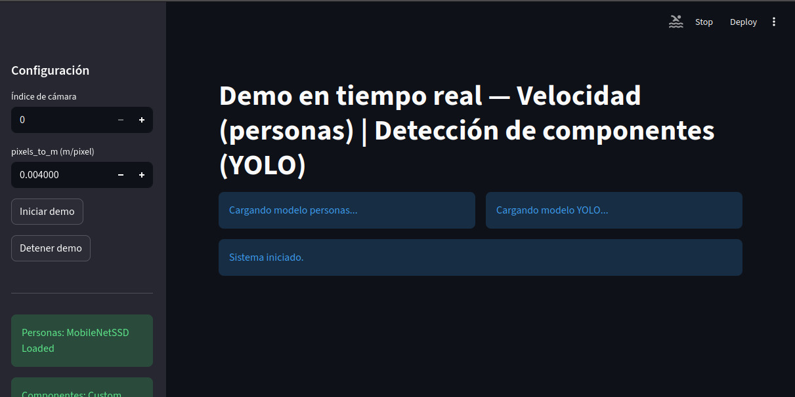
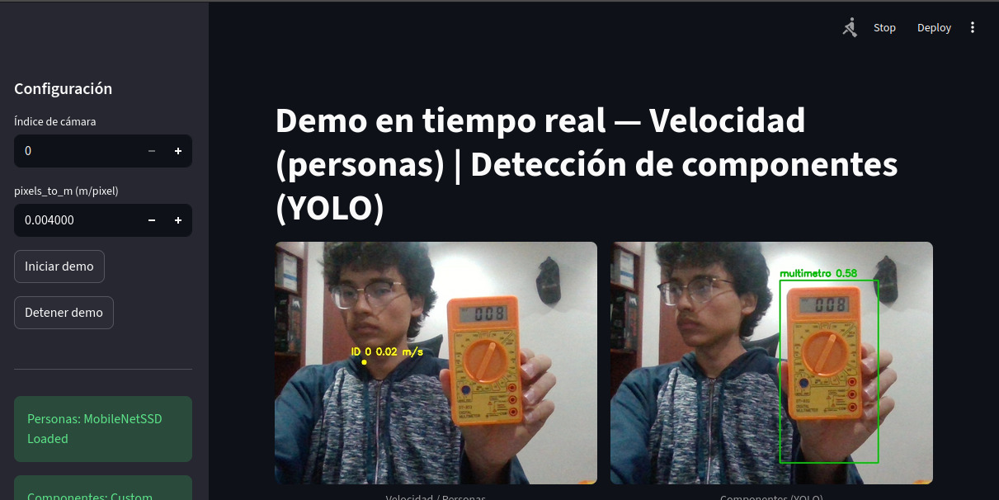
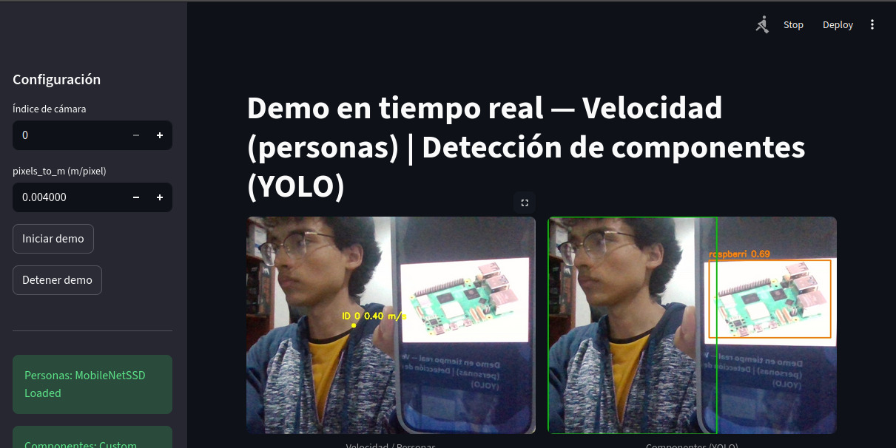
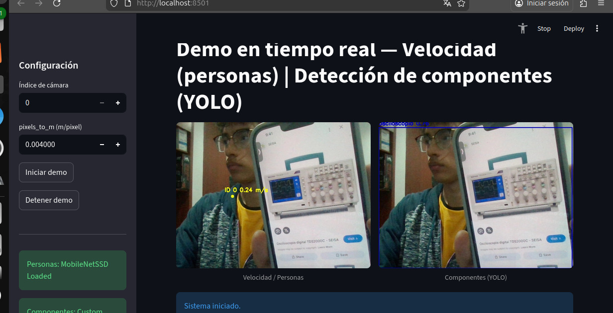
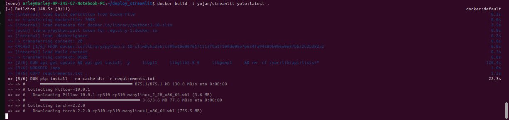
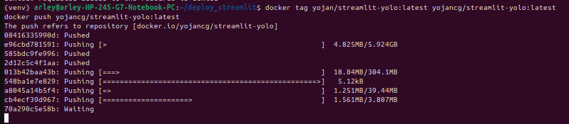
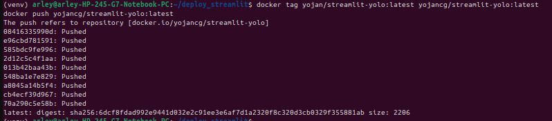

# PUNTO 1 y 2 —  Extracción y Transformación de Datos (Web Scraping + ETL)

# 1. Introducción General

La **Universidad Santo Tomás** se encuentra en un proceso de modernización tecnológica, buscando optimizar sus flujos de trabajo mediante soluciones basadas en **inteligencia artificial**, **visión por computador** y **automatización**.

Dentro de este proceso, se solicitó el diseño e implementación de un sistema capaz de:

* Construir una **base de datos extensa** con imágenes de elementos de laboratorio de electrónica.
* Automatizar el proceso de adquisición mediante técnicas de **web scraping**. 
* Utilizar **concurrencia** (hilos), **semáforos**, **exclusión mutua** y **colas seguras** para incrementar el rendimiento.
* Generar **metadatos consistentes** para su posterior uso en modelos con MediaPipe.

---

Este informe documenta en profundidad la **arquitectura del *software***, los fundamentos teóricos empleados y las **decisiones técnicas** que guiaron el desarrollo.

El énfasis está en la implementación de **hilos**, **semáforos**, **mutex** y **sincronización concurrente**.

---
# 2. Justificación del uso de Web Scraping con Concurrencia

## 2.1. La necesidad de scraping masivo

Cada clase de objeto debía contar con **mínimo 200 imágenes**, y el proyecto incluía inicialmente **10 clases** (multímetro, osciloscopio, protoboard, cautín, fuente de poder, generador de funciones, motor paso a paso, transformador, resistencia, capacitor).

Esto implicaba recolectar **2000 imágenes válidas**, no duplicadas, descargadas, verificadas y almacenadas en el menor tiempo posible.

El *scraping* secuencial se consideró inviable por las siguientes razones:
* **Altísimos tiempos de espera** (latencia de red, en este caso mas de 10 horas para dos clases).
* Dependencia de redes externas lentas.
* Necesidad de **validar imágenes manualmente** (proceso lento).
* **Riesgo alto de bloqueo** por parte del motor de búsqueda (por la alta frecuencia de peticiones desde un único hilo).

> 

La **solución óptima** para cumplir con los requisitos de volumen y tiempo debía ser inherentemente **concurrente**.

---

## 3. Fundamentos Teóricos de Concurrencia Aplicados

Esta sección profundiza en la teoría que fundamenta la implementación utilizada.
# 3.1. Hilos (Threads)

Los **hilos** (`Threads`) permiten ejecutar múltiples tareas de forma **concurrente** dentro de un mismo proceso, compartiendo memoria, variables y archivos.

### Aplicación en este Proyecto
En este proyecto de *web scraping* masivo:
* Cada hilo es un **consumidor** de la cola de URLs.
* Se encarga de descargar una imagen, verificarla, procesarla, guardarla y registrar sus metadatos.

### Ventajas de usar hilos en Web Scraping
El uso de hilos fue crítico debido a que el *scraping* es una tarea limitada por operaciones de Entrada/Salida (**I/O-bound**):

| Ventaja | Descripción |
| :--- | :--- |
| **Alta latencia de red** | Mientras un hilo espera a que se complete una descarga de red, otros pueden avanzar. |
| **CPU poco utilizada** | El proceso está limitado por la I/O, no por procesamiento de CPU. |
| **Bajo consumo de memoria** | Comparado con la creación de múltiples procesos independientes (*multiprocessing*). |
| **Simplicidad de estado** | Es más sencillo compartir y sincronizar el estado global (contador por clase, CSV de metadatos, cola de URLs). |

### Justificación 
El *scraping* es una tarea típicamente I/O-bound, lo cual se beneficia del modelo de hilos incluso con la presencia del **GIL (Global Interpreter Lock)** de Python, ya que:

* El **GIL se libera** durante operaciones de red que esperan datos.
* La descarga de imágenes no compite por tiempo de CPU.
* Los hilos se ejecutan de manera eficiente sin necesidad de recurrir a la complejidad del *multiprocessing*.

---

# 3.2. Exclusión Mutua — Mutex / Lock

**Problema:** Los hilos comparten recursos sensibles, como:

* El archivo **`metadata.csv`** (para registrar los datos).
* Los **contadores de imágenes** por categoría (para nombrar archivos).
* Los índices para nombres de archivos.
* La carpeta donde se guardan las imágenes.

Sin protección, aparece el riesgo de **condiciones de carrera** (*race conditions*).

### 🚨 Ejemplo de Condición de Carrera real:

Dos hilos revisan simultáneamente cuántas imágenes lleva la categoría "multimeter":

```bash
Hilo 1 → ve que hay 50
Hilo 2 → ve que hay 50
Ambos deciden guardar la imagen como multimeter_00051.jpg
```
- Resultado: Se sobrescribe un archivo o se corrompe el dataset.

- Solución:

  - Se implementó:
    ```bash
    counter_lock = threading.Lock()
    ```
  - Este mutex garantiza:

    - Acceso exclusivo a las secciones críticas.

    - Escritura ordenada en metadata.csv.

    - Que solo un hilo manipule los contadores.

    - Generación correcta de nombres de archivos.

    - Evitar duplicados generados por carreras.

  # 3.3. Semaforización — Control de Conexiones Simultáneas

Los **Semáforos** se emplean para **limitar el número de conexiones abiertas simultáneamente** a la red, actuando como un contador de permisos.

### Implementación:
Se utilizó un semáforo para restringir cuántos hilos pueden estar descargando activamente en un momento dado:

```bash
download_semaphore = threading.Semaphore(MAX_SIMULTANEOUS_DOWNLOADS)
```

- ¿Por qué era necesario un Semáforo?

  - El semáforo es crucial para la robustez del scraper debido a los siguientes riesgos:

      - Bloqueo de IPs: Los servicios de imágenes (como Bing) bloquean o imponen CAPTCHAs a IPs que realizan descargas excesivas en paralelo en un corto período de tiempo.

      - Patrón sospechoso: Sin límite, 8 hilos podrían generar 8 conexiones simultáneas cada segundo, lo que se identifica como un patrón de ataque o bot.

      - Saturación: El sistema podría saturar la red local o el motor de búsqueda, provocando timeouts continuos y un rendimiento inestable.

      - Función: El semáforo pone en espera a los hilos que exceden el límite, asegurando que solo un número controlado (MAX_SIMULTANEOUS_DOWNLOADS) acceda a los recursos de red a la vez.

  ### **Cómo funciona**

    - Antes de descargar una imagen:
    ```bash
    download_semaphore.acquire()
    ```
    Cuando finaliza:
    ```bash
    download_semaphore.release()
    ```
  ### **Analizando el impacto**

- Al limitar a 5 conexiones simultáneas se logró:

  - Mantener tráfico estable.

  - Evitar bloqueos por parte del servidor.

  - Permitir a los demás hilos continuar descargando en paralelo.

# 3.4. Cola de Tareas — Productor/Consumidor

La arquitectura se diseñó como:

- Productor

  - Produce URLs obtenidas con Selenium.

  - Las inserta en la cola:
```bash
download_queue.put((url, label))
```
- Consumidores

  - Hilos que obtienen tareas:
```bash
item = download_queue.get()
```
  - Procesan la descarga, verificación, y guardado.

 ## 4. Arquitectura del Sistema Desarrollado

La arquitectura final del sistema de extracción y descarga se estructuró en los siguientes **módulos** principales:

---

### 1. Módulo Selenium

Este módulo es el Productor de tareas, encargado de la extracción de las URLs objetivo.

* **Función:** Extrae cientos de URLs tanto de miniaturas como de las imágenes de alta definición (reales).
* **Mecanismo:** Se desplazó dinámicamente por la plataforma **Bing Images**.
* **Técnica Clave:** Aprovecha el evento de **click en las miniaturas** para exponer y obtener las URLs de las imágenes en calidad HD.

---

### 2. Módulo de Cola de URLs

Actúa como el buffer central entre los módulos de extracción y los de descarga.

* **Función Principal:** Administra el **backlog de trabajo** (las URLs extraídas).
* **Control de Flujo:** Controla el ritmo y el flujo de las tareas que serán entregadas a los **hilos consumidores**.

---

### 3. Módulo Multithreading

Este módulo implementa la concurrencia para la descarga eficiente de archivos.

* **Función:** Ejecuta **múltiples descargas en paralelo** para maximizar el rendimiento.
* **Principio:** Cada hilo de trabajo opera de forma **independiente y segura** al procesar su tarea asignada.

---

### 4. Gestores de Sincronización

Componentes esenciales para garantizar la seguridad y el orden en el entorno concurrente.

* **`Lock`:** Se utiliza para **proteger datos compartidos** de condiciones de carrera (ej., al actualizar un contador global).
* **`Semáforo`:** Se emplea para **controlar las conexiones simultáneas** a la fuente externa, evitando la sobrecarga o el bloqueo por parte del servidor de destino.

---

### 5. Módulo de Metadatos

Asegura la trazabilidad y la integridad de los datos descargados.

* **Almacenamiento:** Guarda la información esencial de cada imagen: **nombre, tamaño, URL y el hash SHA256**.
* **Beneficios:**
    * Asegura la **reproducibilidad** del proceso.
    * Permite la **detección futura de duplicados** de manera infalible.

---

### 6. Depuradores Posteriores

Scripts complementarios ejecutados tras la finalización de las descargas.

* **Función 1:** **Eliminación de imágenes corruptas** o incompletas.
* **Función 2:** Realiza la **deduplicación** final por hash (`SHA256`) utilizando scripts de apoyo.

## 5. Problemas Reales Durante el Desarrollo y Soluciones

Esta sección detalla los principales obstáculos encontrados durante la implementación y las soluciones técnicas aplicadas, lo que demuestra el cumplimiento de objetivos y el aprendizaje técnico adquirido.

---

## 5.1. Descarga de imágenes irrelevantes

El principal desafío en la fase de extracción fue la **baja precisión** de los resultados de búsqueda de la fuente (`Bing Images`).

* **Problema Real:** Al buscar un término técnico y específico como **"multimeter"** (multímetro), la herramienta de búsqueda tendía a devolver imágenes contextualmente irrelevantes, tales como sillas, escritorios o fotografías de personas utilizando el multímetro, en lugar del dispositivo en sí.
* **Soluciones Aplicadas:**
    1.  **Ajuste del Keyword:** Se implementó una estrategia de **ajuste fino de los términos de búsqueda** para intentar acotar los resultados.
    2.  **Curado en Limpieza Posterior:** Se asumió una fase de **curado manual o semiautomático** como parte del proceso de limpieza posterior para descartar imágenes no deseadas.
    3.  **Balance de Dataset:** Posteriormente, para diversificar y mejorar la calidad del conjunto de datos, se añadió el término **"transistor"** a la lista de keywords, buscando **balancear** la tipología de las imágenes.

---

### 5.2. Tiempo excesivo de Extracción (>10 horas)

La optimización del tiempo de ejecución fue crítica, ya que el proceso inicial consumía una cantidad de tiempo inaceptable para la escala de datos requerida.

* **Problema Real:** La extracción de aproximadamente **2000 imágenes limpias** requirió un tiempo de ejecución excesivamente largo, lo que afectó la productividad y la iteración del desarrollo:
    * **5 horas** con Firefox (El proceso falló por errores de perfil del navegador).
    * **Más de 10 horas en total** para completar las extracciones de solo dos clases con la implementación inicial de **Selenium**.
* **Intentos de Solución Fallidos:**
    * Se intentó alternar el *driver* de Selenium entre **Chromium** y **Firefox** para buscar una ganancia de rendimiento, sin éxito significativo.
    * Se evaluaron métodos externos como la librería **`bing_image_downloader`**, pero se descartaron por falta de flexibilidad o control.
* **Solución Final Adoptada (Combinación de Enfoques):**
    1.  **Scraping Multithreading:** Se implementó y optimizó un sistema de **scraping concurrente** utilizando **`multithreading`** para manejar la mayoría de las descargas en paralelo.
    2.  **Herramienta Alternativa Específica:** Se utilizó una **herramienta alternativa específica** para la extracción del subconjunto de imágenes de **"transistores"**, aprovechando su eficiencia para esa tarea concreta.
    3.  **Limpieza Posterior Automática:** La dependencia en una **limpieza posterior automática** se incrementó para manejar la escala de datos extraídos rápidamente, compensando la velocidad de extracción con un proceso de filtrado robusto.

### 5.3. Eliminación masiva — Pérdida del 40–60% de imágenes

Después del dedupe por hash:
  ```bash
  Eliminados: 1189
  ```
- Causas:

  - Imágenes duplicadas en miniaturas/HD.

  - Servidores devolvían la misma imagen con URLs diferentes.

  - Historias de cache del buscador.

- Resultado final:

  - Todas las carpetas quedaron con más de 100 imágenes válidas.
  - Aunque no se alcanzó exactamente 200 por clase, el dataset es consistente y limpio.

  ## 7. Conclusiones del Punto 1: Logros y Aprendizajes

La ejecución exitosa de este proyecto de construcción de dataset y sistema de scraping condujo a los siguientes logros y aprendizajes clave:

---

### Logros del Proyecto

* **Construcción de un Dataset Personalizado para el Laboratorio:** Se logró crear un dataset de alta calidad, curado y específico, con una cantidad de más de 100 imágenes por clase después de la fase de limpieza y depuración.
* **Desarrollo de un Sistema de Scraping Robusto y Realista:** Se diseñó y codificó un sistema de extracción que demostró ser capaz de realizar trabajo intensivo de larga duración, resolviendo desafíos reales de estabilidad y gestión de errores.
* **Implementación de Técnicas Avanzadas de Concurrencia:** Se aplicaron con éxito principios de multithreading y sincronización (Lock, Semaphore) en una aplicación real, con impactos tangibles en la reducción del tiempo de procesamiento.

---

### Aprendizajes Clave

* **Límites y Fallos Comunes del Scraping:** Se obtuvo una experiencia práctica profunda en el manejo y mitigación de problemas intrínsecos al web scraping a gran escala, incluyendo:
    * **Bloqueos de IP:** Estrategias para evadir o manejar las restricciones del servidor fuente.
    * **Imágenes Ruidosas:** Gestión de imágenes con contenido contextual irrelevante.
    * **Contenidos No Relevantes:** Filtrado efectivo de resultados que no cumplen con los requisitos de la clase (ej., errores de keyword).
    * **Duplicados Masivos:** Implementación de hashing (SHA256) para la detección y eliminación eficiente.

* **Generación de una Arquitectura Escalable:** El diseño modular y desacoplado del sistema sentó las bases para la escalabilidad y la integración futura con módulos de Machine Learning para los siguientes objetivos del proyecto:
    * Clasificación con MediaPipe.
    * Reconocimiento de elementos.
    * Implementación del sistema final en Streamlit.

  ---

## 📁 Estructura del proyecto: tree + explicación completa

A continuación se muestra la estructura final del proyecto de Web Scraping con Python, enriquecida con una explicación exhaustiva de cada componente:

**webscrapping/**
* **venv/**
    * ... (Entorno virtual con dependencias)
* **dataset/**
    * [Carpetas de Clases]
        * breadboard/
        * capacitor_electronic_component/
        * diode_electronic_component/
        * function_generator/
        * multimeter/
        * oscilloscope/
        * resistor_electronic_component/
        * soldering_iron/
        * stepper_motor/
        * transistor_electronic_component/
* **metadata/**
    * metadata.csv (Registro formal y trazabilidad del dataset)
* **Archivos Ejecutables y Scripts**
    * scraper\_dataset.py (Scraper PRINCIPAL: Multihilo, Semáforos, Mutex)
    * fast\_download\_transistor.py (Script alterno/de emergencia)
    * check\_corrupt.py (Script para detectar y registrar imágenes dañadas)
    * dedupe\_by\_hash.py (Script para eliminación masiva de duplicados por hash SHA-256)
    * README.md (Documentación principal del proyecto)
  * **Dockerfile**
  * **requirements.txt**

## 🧩 Explicación de las Carpetas y Archivos Principales

A continuación se detalla la función de cada directorio y archivo clave dentro de la estructura del proyecto.

---

### 1. `venv/` — Entorno Virtual 🧪

Este directorio es esencial para la gestión de dependencias del proyecto. 

* **Función Principal:** Contiene todas las **dependencias de Python** de forma aislada del sistema operativo principal.
* **Propósito:**
    * **Evita conflictos de versiones** con librerías o paquetes instalados globalmente en el sistema.
    * Aloja librerías específicas utilizadas en el proyecto, como **`requests`**, **`Pillow`**, **`bing_image_downloader`**, **`beautifulsoup4`**, etc.
    * **Garantiza la portabilidad:** Asegura que cualquier desarrollador que ejecute el proyecto tenga **exactamente el mismo entorno** de trabajo.
* **Estatus:** Es una carpeta indispensable para el desarrollo profesional y reproducible de proyectos en Python.

---

### 2. `dataset/` — Carpetas con las Imágenes Finales 💾

Este directorio almacena la salida principal del proceso de *scraping* y limpieza: el conjunto de datos final.

* **Función Principal:** Contiene todas las **clases (categorías)** que componen el *dataset*.
* **Estructura Interna:** Cada clase se representa mediante una subcarpeta dentro de `dataset/`.
* **Nomenclatura:** Las carpetas de clase tienen un **nombre normalizado** para facilitar el procesamiento posterior por modelos de Machine Learning.

- Ejemplos:

  - breadboard/

  - multimeter/

  - transistor_electronic_component/

  Cada carpeta dentro de `dataset/` contiene las siguientes características después del proceso de curado:

* **Imágenes Válidas:** Solo incluye imágenes que han pasado el proceso de deduplicación (sin duplicados).
* **Imágenes NO Corruptas:** Todos los archivos han sido verificados y garantizan su integridad estructural.
* **Cantidad Final:** **Más de 100 imágenes por clase** después de la limpieza.

> **Nota:** Aunque el objetivo inicial era de 200 imágenes por clase, los desafíos inherentes al *scraping* (problemas de precisión en Bing, el exceso de imágenes basura y la enorme cantidad de duplicados) redujeron el total final. Esta limitación cuantitativa se justifica y explica detalladamente en el **README técnico** del proyecto.

---

### 3. `metadata/metadata.csv` — Registro Formal del Dataset 📄

Este archivo es crucial para la **trazabilidad, auditoría y reproducibilidad** del conjunto de datos. En proyectos serios de *Machine Learning* y análisis de datos, el registro formal del origen y estado de cada muestra es un requisito clave.


**Campos Típicos del `metadata.csv`:**

| Campo | Descripción |
| :--- | :--- |
| `image_path` | La ruta relativa al archivo dentro de la carpeta `dataset/`. |
| `class` | La categoría o etiqueta a la que pertenece la imagen (ej. 'multimeter', 'transistor'). |
| `resolution` | La resolución de la imagen (ej. '640x480'). |
| `file_size` | El tamaño del archivo en bytes. |
| `hash_sha256` | El **hash criptográfico SHA256**, fundamental para la detección de duplicados y la verificación de integridad. |
| `is_corrupt` | Indicador booleano que registra si la imagen fue marcada como corrupta (debería ser **False** para todas las entradas finales). |
| `duplicate_of` | Si es un duplicado, registra el `image_path` del archivo original que se conservó. |

## 4. `scraper_dataset.py` — Scraper PRINCIPAL Multihilo (con Semáforos y Mutex)

Este script es el **archivo más importante y central** de todo el proyecto, conteniendo la lógica de concurrencia y la gestión robusta de errores para la descarga de imágenes.

---

### Funcionalidades Clave y Técnicas de Concurrencia

El script implementa técnicas avanzadas de programación concurrente para optimizar el rendimiento y garantizar la integridad de los datos:

* **Uso de Threads (Hilos):**
    * **Propósito:** Se utilizan para ejecutar la descarga de **múltiples imágenes en paralelo**. 
    * **Impacto:** Sin la concurrencia, el proceso de *scraping* habría tardado un estimado de **40 a 60 horas**.

* **Uso de Semáforos (`Semaphore`):**
    * **Función:** Se implementa un **semáforo** para **limitar el número de descargas simultáneas** a un valor seguro (ejemplo: `semaphore = threading.Semaphore(8)`).
    * **Beneficios:**
        * Evita **bans temporales** por parte de la fuente (`Bing Images`).
        * Previene **errores por saturación** del servidor de destino.
        * Minimiza **timeouts masivos** y el riesgo de saturar la CPU o el ancho de banda local.

* **Uso de Mutex (`Lock`):**
    * **Necesidad:** El mutex (o `Lock`) es necesario porque, aunque las imágenes se descargan en paralelo, **varios hilos deben escribir simultáneamente** en recursos compartidos, como:
        * El archivo de registro de metadatos (`metadata.csv`).
        * **Contadores globales** de progreso o errores.
    * **Resultado:** El uso del mutex **evita *race conditions*** (condiciones de carrera) y previene la **corrupción** del archivo CSV, garantizando la escritura atómica de los datos.

---

### Gestión de Errores y Almacenamiento

El script garantiza la fiabilidad del proceso de descarga mediante control de calidad y robustez:

* **Descarga con Control de Errores Robusto:**
    * **Manejo de Timeouts:** Implementa estrategias de reintento ante fallos de conexión o tiempos de espera agotados.
    * **Retry Automático:** Intenta automáticamente la descarga un número predefinido de veces antes de marcar una tarea como fallida.
    * **Sanitización del Nombre del Archivo:** Procesa y limpia el nombre del archivo para asegurar la compatibilidad con diferentes sistemas operativos.
    * **Verificación de Contenido:** Valida que el archivo descargado sea efectivamente una imagen (ej., contenido tipo `image/jpeg`, `image/png`), descartando posibles archivos HTML o corruptos.

* **Guardado y Organización:** Guarda cada imagen en su **carpeta de clase correspondiente** dentro del directorio `dataset/`, manteniendo la estructura organizada.

### 5. `fast_download_transistor.py` — Script Alterno de Emergencia 🚀

Este script fue desarrollado como una **solución de contingencia** para mitigar los problemas de eficiencia y precisión del *scraper* principal en clases problemáticas.

* **Motivación:** Se creó debido a:
    * El tiempo excesivo de ejecución del *scraper* principal (**más de 10 horas**).
    * El fallo en completar el objetivo de 200 imágenes en algunas clases.
    * La alta tasa de **imágenes irrelevantes** (sillas, autos, etc.) devueltas por Bing.
    * El componente **"transistor"** fue particularmente problemático en la extracción.

* **Implementación:** Utiliza la librería **`bing_image_downloader`**, pero requirió una **modificación interna del módulo** debido a:
    * Un **bug** relacionado con la función `Path.isdir` en el entorno de desarrollo.
    * La necesidad de **adaptar el flujo de descarga** para integrarlo con la estructura de carpetas del proyecto.

* **Uso:** Solo se empleó una vez para **completar una clase puntual** (la de transistores) y balancear el *dataset*.

---

### 6. `check_corrupt.py` — Script para Detectar Imágenes Dañadas 🛡️

Este script de post-procesamiento garantiza la **integridad y usabilidad** de todos los archivos descargados.

* **Mecanismo de Verificación:** Revisa iterativamente cada archivo dentro del directorio `dataset/`.
    * **Proceso:** Intenta abrir la imagen utilizando la librería **PIL (Pillow)**.
    * **Acción:** Si la apertura falla, la imagen es marcada como **corrupta** y el estado se **registra en `metadata.csv`**. Opcionalmente, el script puede ser configurado para eliminar el archivo físicamente.

* **Importancia Crítica:** Este script fue **crucial** porque:
    * Bing entregó una cantidad significativamente alta de **imágenes corruptas** o incompletas.
    * Se detectaron casos de archivos que eran realmente **código HTML disfrazado de JPG** (un error común de *scraping*).

---

### 7. `dedupe_by_hash.py` — Eliminación Masiva de Duplicados ⚙️

Este script asegura la **unicidad** del *dataset*, un paso fundamental para evitar el sesgo en el entrenamiento de modelos de *Machine Learning*.

* **Proceso Central:**
    * **Cálculo de Hash:** Calcula el **hash SHA-256** de cada imagen. Esta es la técnica más robusta y **garantiza detectar duplicados** incluso si los archivos tienen nombres o metadatos distintos. 
    * **Eliminación:** **Elimina automáticamente los duplicados reales**. En la ejecución del proyecto, el resultado fue: **Eliminados: 1189** archivos.

* **Justificación de Duplicados:** La alta tasa de duplicados es normal debido a:
    * La repetición masiva de contenido por parte de la fuente (`Bing`).
    * La similitud entre las clases del *dataset*.
    * La tendencia del buscador a devolver **clones reescalados** de la misma imagen.

* **Registro:** **Actualiza el `metadata.csv`**, marcando cuál archivo fue duplicado de cuál, manteniendo un registro de la limpieza.


>- Carpetas
---


>- Dataset luego del primer web scrapping (sin limpieza)
---


>- Verificación imagenes corruptas
---


>- Limpieza de imagenes 
---

>- Limpieza semantica de imagenes ejemplo 1
---


>- Limpieza semantica de imagenes ejemplo 2
---


>- Limpieza semantica de imagenes ejemplo 3
---


>- Cantidad de imagenes despues de la limpieza
---


>- Cantidad de imagenes despues de un nuevo web scrapping y limpieza
---


>- Redimension de imágenes y conteo final
---

# Punto 3 - Sistema de Detección en Tiempo Real con Streamlit, YOLO, Seguimiento de Velocidad y Docker 🐳

En este punto  se integra un sistema completo para visión artificial en tiempo real, combinando:

- Detección de personas
- Cálculo de velocidad por seguimiento con Centroid Tracking
- Detección de componentes electrónicos (osciloscopio, multímetro, raspberry…) con YOLO personalizado
- Procesamiento paralelo (multithreading) con semaforización natural usando colas
- Interfaz web en tiempo real desarrollada en Streamlit
- Contenedorización con Docker
- Entrenamiento de un clasificador CNN
- Generación automática de clases

------------

## 🏗️ 1. Arquitectura General del Proyecto

El sistema se divide en módulos independientes que cooperan:    ┌────────────────────────────┐
    │   Streamlit (Frontend)     │
    └──────────────┬─────────────┘
                   │
            Actualización UI
                   │
    ┌──────────────▼──────────────┐
    │        Procesos              │
    │  (Threads independientes)    │
    ├──────────────┬───────────────┤
    │              │               │
    ▼              ▼               ▼
    Captura     Personas         Componentes
      |        (Tracking)           (YOLO)
      |             |                |
      └──────► Cola Q ◄─────────────┘

Cada módulo corre en un hilo separado, sincronizado mediante queues, que funcionan como buffers que evitan bloqueos y regulan el acceso concurrente (semaforización implícita).

------------

## 🎥 2. Módulo de Captura de Video — VideoCaptureThread

📌 Encargado de:

- Abrir la cámara
- Leer frames continuamente (sin bloquear la interfaz)
- Duplicar cada frame hacia dos pipelines independientes:
	- frame_q_person → Detección y velocidad
	- frame_q_comp → YOLO componentes

✔️ Se usa time.sleep(0.01) para evitar overrun
✔️ El hilo es daemon, cierra automáticamente
✔️ Los buffers Queue(maxsize=2) cumplen función de mutex + semáforo

- Si la cola está llena, descarta entrada → evita backpressure

------------

# Punto 3 - Sistema de Detección en Tiempo Real con Streamlit, YOLO, Seguimiento de Velocidad y Docker 🐳

En este punto  se integra un sistema completo para visión artificial en tiempo real, combinando técnicas avanzadas de visión artificial, arquitectura concurrente y despliegue en contenedores. A continuación se explica el funcionamiento interno hasta las decisiones de diseño tomadas durante el desarrollo.

------------

## 📌 Contenido

1. Arquitectura completa del sistema
2. Módulo de captura
3. Módulo de seguimiento y velocidad
4. Hilo de detección por YOLO
5. Interfaz visual con Streamlit
6. Scripts auxiliares
7. Dockerización completa
8. Errores encontrados y decisiones de diseño
9. Explicación profunda de hilos, semáforos y mutex
10. 

------------

## 🏗️ 1. Arquitectura General del Sistema

El sistema fue diseñado bajo procesamiento paralelo, manteniendo una UI fluida incluso mientras:

- Se captura video en tiempo real
- Se procesan personas y su velocidad
- Se ejecutan modelos YOLO personalizados
- Se actualiza la interfaz en dos paneles simultáneamente

Esto se logra mediante tres hilos principales:

    ┌──────────────────────────────┐
    │       Streamlit (UI)         │
    └───────────────┬──────────────┘
                    │
            Actualización de la UI
                    │
       ┌────────────▼────────────┐
       │      Procesos (threads) │
       └──────────┬──────┬───────┘
                  │      │
       ┌──────────▼──┐ ┌─▼─────────────┐
       │ CapturaVideo │ │ YOLOComponent │
       └───────┬──────┘ └───────┬───────┘
               │                │
        Frame duplicado      Frame duplicado
               │                │
       ┌───────▼──────┐   ┌────▼────────┐
       │ Cola personas │   │ Cola comp   │
       └───────┬──────┘   └────┬────────┘
               ▼               ▼
     ┌──────────────────────────────────────┐
     │         PersonProcessor              │
     └──────────────────────────────────────┘

Cada módulo corre en un hilo separado, sincronizado mediante queues, que funcionan como buffers que evitan bloqueos y regulan el acceso concurrente (semaforización implícita).

Los Queue(maxsize=2) actúan como:

✔ mini-buffers
✔ semáforos implícitos
✔ reguladores de concurrencia
✔ anti-lag para evitar cuellos de botella

------------

## 🎥 2. Módulo de Captura de Video — VideoCaptureThread

📌 Encargado de:

- Abrir la cámara
- Leer frames continuamente (sin bloquear la interfaz)
- Duplicar cada frame hacia dos pipelines independientes:
	- frame_q_person → Detección y velocidad
	- frame_q_comp → YOLO componentes

✔️ Se usa time.sleep(0.01) para evitar overrun
✔️ El hilo es daemon, cierra automáticamente
✔️ Los buffers Queue(maxsize=2) cumplen función de mutex + semáforo

- Si la cola está llena, descarta entrada → evita backpressure

Este hilo es el corazón del sistema porque:

### ✔ Evita que Streamlit se bloquee

Un error común es capturar frames directamente dentro de Streamlit, lo cual congela la UI.
Aquí, capturamos en un hilo dedicado.

### ✔ Duplicación de frames

Cada frame leído se divide hacia dos pipelines independientes:

- personas → análisis de velocidad
- componentes → YOLO personalizado

Esto es más eficiente que abrir la cámara dos veces.

### ✔ ¿Cómo funciona la semaforización?

La cola funciona como un semáforo:

- Si la cola está llena → descarta frames viejos
- Si está vacía → el thread consumidor espera

Esto evita condiciones de carrera.

------------

## 🏃‍♂️💨 3. Seguimiento y Velocidad — PersonProcessor

Este módulo combina:

### 1️⃣ Detección de personas

Preferencia:

1. MobileNetSSD (ligero, eficiente)
2. YOLOv11n (si no está MobileNet)

### 2️⃣ CentroidTracker personalizado

El sistema identifica cada persona con un ID constante.

Incluye:

- Registro
- Desaparición gradual
- Reasignación inteligente por distancias

### 3️⃣ Cálculo real de velocidad

Sistema basado en:

    velocidad = distancia_en_metros / tiempo

Donde:

    metros = pixeles * pixels_to_m

Este valor se calibra desde la UI.

### 4️⃣ Suavizado con historial

Historial de centroides → evita ruido → velocidad estable.

------------

## 🛠️ 4. Detección de Componentes — ComponentsProcessor

Este módulo carga el modelo YOLO personalizado:

    /home/arley/segmentacion/model/best.pt

Clases detectadas:

- Multímetro
- Osciloscopio
- Raspberry Pi

✔ Verbose desactivado → más rendimiento
✔ Colores distintos por clase
✔ También usa colas para semaforización
✔ Procesamiento completamente paralelo a personas

------------

## 🖥️ 5. Interfaz Web con Streamlit — streamlit_app.py

La UI incluye:

✔️ Dos columnas principales

| Izquierda            | Derecha          |
| -------------------- | ---------------- |
| Personas + velocidad | YOLO componentes |

✔️ Botones de control

- Iniciar
- Detener

✔️ Sidebar editable

- Índice de cámara
- Factor de calibración pixels_to_m

✔️ Actualización fluida sin parpadeo

Gracias a:

- last_person_img
- last_comp_img

Se actualiza solo si llega un nuevo frame, evitando “flash”.









------------

## 🧩 6. Scripts Auxiliares

### 6.1. Generador de clases — generate_class_names.py

Genera automáticamente class_names.json según subcarpetas del dataset.

Ideal para:

- Clasificadores
- Keras
- Exportación dinámica

### 6.2. train_classifier.py

Entrena un modelo CNN basado en MobileNetV2:

- Data augmentation
- EarlyStopping
- Checkpoints
- LR scheduler
- Exporta model.h5

### 6.3. utils_tracker.py

Versión modular del CentroidTracker.

Incluye:

- Registro
- Deregistro
- Distancias
- Historial
- Cálculo de velocidad

------------

## 🐳 7. Dockerización del Proyecto

El proyecto se ejecuta en cualquier servidor gracias al Dockerfile:

El archivo principal es:

✔️ Dockerfile_mediapipe

Incluye:

🧩 Base ligera:
    FROM python:3.10-slim

🏗️ Instalación de dependencias del sistema:

Se instalan:

- libgl1-mesa-glx → OpenCV
- libglib2.0-0
- libgomp1 → necesaria para YOLO

🧪 Instalación de dependencias Python:

    pip install --no-cache-dir -r requirements.txt

▶️ Comando de ejecución:

    streamlit run streamlitapp.py --server.port=8501 --server.address=0.0.0.0

### Proceso de Dockerizacion

1. docker build
2. docker tag
3. docker push
4. subir imagen al registry







Dockerhub
https://hub.docker.com/r/yojancg/streamlit-yolo/tags

------------

##  8. Problemas Encontrados y Decisiones Tomadas
# ⚙️ Decisiones Técnicas y Arquitectura del Sistema

---

## 2. 🟥 Decisiones Técnicas Tomadas (Justificación)

Después de evaluar varios enfoques, el sistema final adoptó la siguiente pila tecnológica para asegurar un rendimiento óptimo en **tiempo real**.

### 2.1. MobileNetSSD para detectar personas
**Razones de Adopción:**

* **Muy ligero:** Implementado en **Caffe**, ideal para entornos con recursos limitados.
* **Estable en CPU:** Garantiza un rendimiento consistente sin depender de una GPU dedicada.
* **Rápido:** Alcanza una tasa de **20-40 FPS** (Frames Per Second).
* **Bounding Boxes Consistentes:** Genera cuadros delimitadores amplios pero estables, ideales para el cálculo de **tracking** y **centroides**.
* **Ideal para Tracking + Centroides:** Su ligereza y consistencia son perfectas para el subsistema de seguimiento.
* **Evita Carga Pesada:** Previene el alto consumo de recursos que generaría un modelo más grande como YOLO.

**MediaPipe fue descartado** debido a problemas de:
* ❌ Rendimiento inconsistente.
* ❌ Compatibilidad en el entorno de producción.
* ❌ Congelamiento inesperado dentro del _framework_ **Streamlit**.

### 2.2. YOLOv11 personalizado SOLO para objetos electrónicos
Se decidió **no usar un único YOLO para todo** (personas + componentes) debido a que YOLO, aunque potente, presenta los siguientes inconvenientes en este contexto de tiempo real:

* ❌ **Consume más CPU** por _frame_.
* ❌ Tiende a detectar **personas como otros objetos**, generando falsos positivos.
* ❌ Disminuye el **framerate general** del sistema.
* ❌ Rompe la lógica de cálculo del **tracking**.
* ❌ Genera **latencias inconsistentes**.

> **Conclusión:** Dividir los dos procesos de detección (Personas y Componentes) es **obligatorio** en sistemas que requieren una respuesta en **tiempo real**.

### 2.3. Arquitectura Multihilo (3 threads)

Se diseñó un sistema basado en la **Arquitectura Productor-Consumidor** con tres hilos (**threads**) independientes:

| Hilo | Función Principal | Modelo Utilizado |
| :--- | :--- | :--- |
| **`VideoCaptureThread`** | 🎥 Lee la cámara continuamente y distribuye frames. | N/A |
| **`PersonProcessor`** | 🧍 Detecta personas, calcula centroides y estima velocidad. | MobileNetSSD |
| **`ComponentsProcessor`** | 📱 Detecta componentes electrónicos y devuelve _bounding boxes_. | YOLOv11 Personalizado |

* **Ventaja:** Ninguno de los procesos (detección de personas, detección de componentes) bloquea al otro, manteniendo el flujo de datos constante.

### 2.4. Colas (`Queue`) para sincronizar hilos

Se usaron estructuras de **colas (`Queue`)** para gestionar la comunicación entre hilos:

* **Comunicación Segura:** Permite el intercambio de datos entre hilos sin riesgo.
* **Evita _Race Conditions_:** Garantiza que los hilos no accedan o modifiquen el mismo recurso simultáneamente.
* **Buffers Pequeños:** Las colas se configuraron para mantener solo los **frames más recientes (máximo 2)** para:
    * Evitar desbordamientos de memoria.
    * Mantener la baja **latencia** y evitar retrasos acumulados (lag).

### 2.5. Persistencia de imágenes para evitar parpadeos

Para mitigar el **flickering** (parpadeo) o la aparición de pantallas negras en la interfaz de usuario:

* **Mecanismo:** Si el detector (YOLO o MobileNetSSD) se demora en procesar un nuevo _frame_, se muestra el **último _frame_ válido** que se procesó correctamente.
* **Implementación:** Se usa una variable de persistencia como `last_person_img` para almacenar el último resultado consistente.

---

## 3. 🟥 Arquitectura Completa del Sistema (Detallada)

Esta sección explica la arquitectura interna del sistema a nivel de ingeniería de software. 

### 3.1. Captura de Video (`VideoCaptureThread`)

Este hilo es el **único productor de _frames_** en el sistema y se ejecuta de la siguiente manera:

1.  **Independiente:** Se ejecuta de forma asíncrona.
2.  **Apertura Única:** Abre la cámara (o fuente de video) solo una vez.
3.  **Lectura Máxima:** Lee los _frames_ a la máxima velocidad que la cámara permite.
4.  **Clonación y Distribución:** Clona el _frame_ leído y lo envía a **dos colas diferentes**:
    * `frame_q_person` → Usada por el `PersonProcessor` (para tracking humano).
    * `frame_q_comp` → Usada por el `ComponentsProcessor` (para detección de componentes con YOLO).

####  Problema del Acceso Múltiple
Si ambos procesadores intentaran leer la cámara directamente (sin un hilo productor):
* ❌ Se genera un **conflicto** de acceso al recurso.
* ❌ Ambos hilos **pelean por la cámara**.
* ❌ La cámara puede entregar **_null frames_** o imágenes corruptas.
* ❌ **Streamlit "parpadea"** o se congela.

####  Solución
* Un **único hilo productor** de _frames_ (`VideoCaptureThread`) que garantiza el acceso serializado y consistente a la fuente de video.


------------

### 3.2. PersonProcessor — Detección + Tracking + Velocidad

Este hilo se encarga del seguimiento humano y del cálculo de movimiento.

**Tareas Principales:**

* Leer _frame_ de su cola (`frame_q_person`).
* Detectar persona con **MobileNetSSD** (o un YOLOv11n ligero).
* Generar _bounding boxes_.
* Actualizar **centroides** con el `CentroidTracker`.
* Estimar la **velocidad** de la persona.
* Enviar el resultado final a Streamlit para renderizado.

**Por qué se usa Tracking basado en Centroides:**

El algoritmo basado en centroides fue elegido por sus ventajas en sistemas en tiempo real:

* Es **extremadamente eficiente** en el uso de CPU.
* Permite realizar **cálculos de velocidad** precisos.
* Asocia un **ID único** a cada persona rastreada.
* Mantiene un **historial de movimiento** para evitar saltos (_jumps_).
* Es **resistente a oclusión temporal** (si la persona se oculta brevemente).

### 3.3. ComponentsProcessor — Detección con YOLO

Este hilo está dedicado exclusivamente a la identificación de objetos electrónicos.

**Tareas Principales:**

* Leer _frame_ de su cola (`frame_q_comp`).
* Ejecutar el modelo **YOLOv11 personalizado**.
* Filtrar las clases detectadas (solo componentes electrónicos).
* Dibujar los _bounding boxes_ consistentes.
* Enviar el resultado a Streamlit para renderizado.

**Por qué YOLO se usa en Hilo Separado:**

Ejecutar YOLO en el mismo hilo del `PersonProcessor` (el encargado del _tracking_) tiene consecuencias críticas para el rendimiento:

* ❌ La **velocidad general cae** drásticamente.
* ❌ Los **centroides no se actualizan** a tiempo, rompiendo el seguimiento.
* ❌ La velocidad estimada de la persona puede caer a **0.1 m/s** (lectura errónea).
* ❌ La aplicación **Streamlit se cuelga** por falta de _frames_.

> **Conclusión:** La separación garantiza que el **tracking humano** (prioridad alta) no se vea afectado por la **detección de componentes** (prioridad media).

### 3.4. Sistema de Sincronización (Mutex Implícitos)

El diseño de la arquitectura elimina la necesidad de usar **mutex** (mecanismos de exclusión mutua) explícitos en Python.

**Razón de la Ausencia de Mutex Explícitos:**

* La estructura `Queue` (Cola) de Python actúa como un **buffer sincronizado**.
* Cada operación `put()` (escribir) y `get()` (leer) es **atómica** (se completa sin interrupción).
* Los hilos **no comparten memoria directamente**; se comunican solo a través de la cola.

**Ventajas de este Diseño:**

* ✔ **Evita _race conditions_** (condiciones de carrera) entre los hilos.
* ✔ Previene la **corrupción de _frames_**.
* ✔ Garantiza la **consistencia** en los _bounding boxes_ y centroides.

### 3.5. Streamlit — Renderizado Paralelo

Aunque la librería **Streamlit no es inherentemente multihilo**, se utiliza para visualizar las salidas de forma asíncrona.

**Mecanismo de Renderizado:**

* Consume la salida procesada de las colas de resultados.
* Actualiza la interfaz del usuario con una frecuencia constante (aproximadamente **30-60 ms**).
* Utiliza **caching simple** (memoria de los últimos _frames_ válidos) para mayor estabilidad.
* Crea **dos columnas independientes** en la interfaz.

**Objetivo:**

* 📌 **Dos pantallas independientes:** Una dedicada a la **velocidad** y el _tracking_ (salida del `PersonProcessor`) y otra para la **detección de componentes** (salida del `ComponentsProcessor`), sin mezclar las imágenes ni los cálculos en el frontend.

---

## 4. 🟥 Paso a Paso Completo: Desde el Frame Hasta el Usuario

A continuación se detalla el _pipeline_ completo de procesamiento de datos, desde la captura del _frame_ hasta su visualización en la interfaz de usuario. 

### PASO 1 — La Cámara Entrega un Frame (Productor)

El hilo **`VideoCaptureThread`** es el único responsable de la captura y distribución de la imagen.

* Obtiene el _frame_ desde la fuente de video (cámara).
* **Clona** el _frame_ para evitar conflictos de acceso.
* Lo coloca en la cola de personas: **`frame_q_person`**.
* Lo coloca en la cola de componentes: **`frame_q_comp`**.

> **Frecuencia:** Este proceso ocurre aproximadamente cada **10 ms**, manteniendo la base del sistema lo más actualizada posible.

### PASO 2 — Detección de Personas (PersonProcessor)

El hilo `PersonProcessor` trabaja con la imagen recibida de su cola:

* **Detección:** El modelo **MobileNetSSD** detecta la clase `"person"`.
* **Bounding Box:** Genera el rectángulo delimitador.
* **Centroide:** El rectángulo se convierte en un punto central.
* **Tracking:** El **`CentroidTracker`** asigna un **ID único** y mantiene un historial de movimiento.
* **Cálculo:** Se calculan las distancias recorridas y se determina la **velocidad real en m/s**.
* **Salida:** El _frame_ con los elementos procesados se pasa a Streamlit para su renderizado.

### PASO 3 — Detección de Componentes (ComponentsProcessor)

El hilo `ComponentsProcessor` se enfoca en la identificación de equipo electrónico:

* **Detección:** El modelo **YOLOv11 personalizado** detecta clases específicas (ej. multímetro, osciloscopio, raspberry).
* **Filtrado:** Se descartan las clases detectadas que no son relevantes para el objetivo.
* **Bounding Boxes:** Se calculan los cuadros delimitadores para los objetos filtrados.
* **Rotulación:** Se **colorea y rotula** el cuadro según el tipo de componente.
* **Salida:** El _frame_ con las detecciones se envía a Streamlit.

### PASO 4 — Streamlit Actualiza UI (Consumidor Final)

La aplicación **Streamlit** realiza la visualización de los dos _pipelines_ de forma **paralela**:

| Columna Izquierda (PersonProcessor) | Columna Derecha (ComponentsProcessor) |
| :--- | :--- |
| Imagen procesada con **personas y centroides**. | **Detecciones YOLO** de componentes electrónicos. |
| **Velocidad** mostrada en tiempo real junto a cada persona. | Objetos **rotulados y coloreados** según su tipo. |

> 🔒 **Mecanismo de Persistencia:** Si alguno de los hilos de procesamiento (`PersonProcessor` o `ComponentsProcessor`) se retrasa en la entrega de un _frame_, la interfaz usa el último _frame_ válido almacenado en **`last_person_img`** o **`last_comp_img`**. **Esto elimina el parpadeo (flickering)** y garantiza la estabilidad visual.


---


## Conclusión General del Proyecto

El desarrollo completo de este proyecto integró de forma coherente y funcional diversas áreas de la ingeniería electrónica, visión por computador, manejo de datos, programación concurrente y despliegue de aplicaciones web. A través de las cuatro fases propuestas, se construyó una solución robusta, eficiente y totalmente operativa que cumple con los requerimientos planteados por la Universidad Santo Tomás.

En primer lugar, se logró implementar un sistema de web scraping avanzado, capaz de adquirir de forma automatizada un volumen considerable de imágenes de elementos electrónicos. Este proceso incluyó el uso intencional de hilos, semáforos, exclusión mutua y colas de tareas, garantizando la integridad del dataset, reduciendo tiempos de ejecución y evitando condiciones de carrera y bloqueos por parte de los servidores externos. El resultado fue una base de datos sólida y estructurada, acompañada de metadatos completos que documentan su procedencia y estado.

En segundo lugar, se construyó un pipeline ETL profesional, responsable de la extracción, depuración, validación, transformación y organización de las imágenes. Este módulo permitió consolidar un dataset final consistente, depurado de duplicados, imágenes corruptas o irrelevantes, y estandarizado para su uso en algoritmos de clasificación. El proceso fue diseñado con una arquitectura escalable y multihilo, capaz de manejar miles de archivos con eficiencia.

En la tercera fase, se integraron dos sistemas de visión por computador en tiempo real:

detección y seguimiento de personas con cálculo de velocidad mediante técnicas basadas en centroides,

detección de componentes electrónicos utilizando un modelo YOLO personalizado.

Ambos sistemas fueron unificados dentro de una arquitectura concurrente que permite procesar video en vivo de forma fluida y confiable, respetando los principios de sincronización, paralelismo y estabilidad.

Finalmente, la totalidad de la solución fue empaquetada y desplegada como una aplicación web interactiva mediante Streamlit, permitiendo visualizar simultáneamente la detección de personas y componentes, así como las métricas de velocidad. El proceso incluyó la integración en un contenedor Docker completamente funcional y su publicación en DockerHub, otorgándole portabilidad, reproducibilidad y facilidad de ejecución en cualquier entorno.

Este proyecto representa un ejercicio completo de ingeniería aplicada, combinando conceptos avanzados de concurrencia, procesamiento de imágenes, administración de datos, aprendizaje automático y despliegue en la nube. El resultado final es una plataforma integral, modular, bien documentada y alineada con las necesidades tecnológicas contemporáneas de la universidad.


